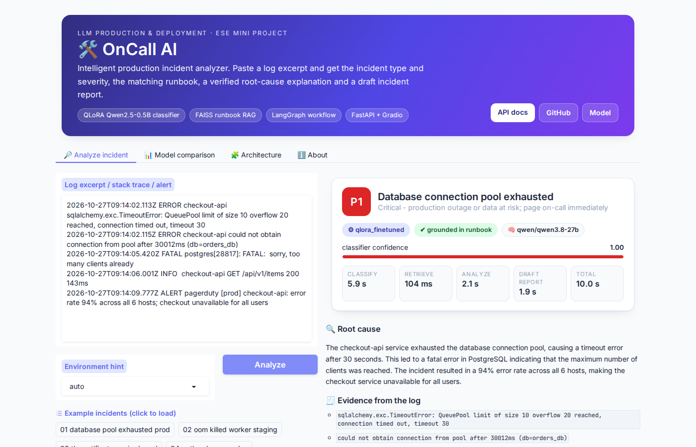
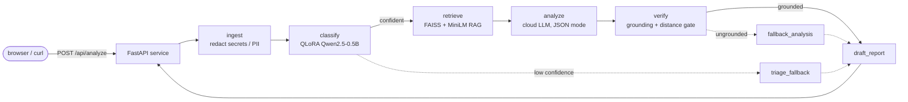

# OnCall AI — Intelligent Production Incident Analyzer

> Paste a log excerpt, stack trace or alert. OnCall AI classifies the incident (type + severity) with a
> **QLoRA-fine-tuned Qwen2.5-0.5B**, retrieves the matching **runbook** with RAG, explains the root cause with a
> cloud LLM **verified against the runbook**, and drafts a blameless **incident report**, all orchestrated by a
> **LangGraph** workflow behind a **FastAPI** service with a **Gradio** interface.

**Author:** Rachit Manish Chheda (UID 2024301004) · LLM Production & Deployment, ESE mini project

| | |
|---|---|
| Live demo | https://rachitst--oncall-ai-web.us-east.modal.run (Modal, serverless CPU; first request after idle takes ~30 s) |
| API docs (Swagger) | https://rachitst--oncall-ai-web.us-east.modal.run/docs |
| Source code | https://github.com/rachitst/oncall-ai |
| Fine-tuned model + model card | https://huggingface.co/rachitst/oncall-ai-incident-classifier (merged QLoRA, Qwen2.5-0.5B-Instruct) |
| Results write-up | [`docs/RESULTS_SUMMARY.md`](docs/RESULTS_SUMMARY.md) (generated from the measured artefacts in `results/`) |



## What it does

1. **Redacts** secrets, tokens, e-mail addresses and IPs before anything is logged or sent to a model.
2. **Classifies** the log into one of 12 incident types and a P1–P4 severity with the fine-tuned model, on CPU.
3. **Retrieves** the runbook, severity policy and known-error records from a FAISS index (Markdown, TXT and CSV sources).
4. **Explains** the root cause and fix steps with a cloud LLM, then **verifies** the answer against the runbook
   (grounding check + distance gate). Unverified answers are flagged *needs human review*.
5. **Drafts** a blameless incident report and returns everything as JSON with per-node timings.

## Concepts covered (from the lab experiments)

| Concept | Experiment | Where in this project |
|---|---|---|
| LoRA / QLoRA fine-tuning, 4-bit NF4 quantization, hyper-parameter comparison | Exp 2, 3 | `training/OnCall_AI_Training.ipynb` → `app/classifier.py` (`FinetunedClassifier`) |
| RAG over multiple file types with a vector index | Exp 4, 5 | `knowledge_base/` (Markdown runbooks, TXT policies, CSV known errors) → `app/knowledge.py` (FAISS) |
| LangGraph stateful workflow with conditional routing and fallbacks | Exp 6 | `app/workflow.py` |
| Production API: validation, error handling, logging, latency, cloud LLM, secrets, deployment | Exp 7 | `app/api.py`, `app/llm.py`, `Dockerfile`, `deploy/modal_app.py` |

## Architecture



The Gradio UI is mounted on the same FastAPI process at `/`; `/health` reports the loaded components and `/docs`
serves the OpenAPI page. The Architecture tab of the app shows the same graph as an interactive diagram.

## Repository layout

```
app/            FastAPI service (api.py), Gradio UI (ui.py), LangGraph workflow, RAG, classifiers, LLM backend, redaction
data/           taxonomy, synthetic dataset generator, generated train/val/test CSVs, UI sample logs
knowledge_base/ 12 runbooks (.md), severity policy / report template / postmortem guide (.txt), known errors (.csv)
training/       Colab notebook: 5-way comparison (rules, zero-shot 0.5B, cloud LLM, LoRA, QLoRA) + model export
eval/           chart generation from results/comparison.json
results/        comparison.json, figures/, predictions, smoke-test outputs (committed after training)
tests/          pytest suite (offline: mock LLM, hash embeddings, rules classifier)
scripts/        smoke_test.py, screenshots.py, make_results_summary.py, make_model_card.py, deploy_space.py, run_local.sh
deploy/         Modal deployment (modal_app.py) and Hugging Face Space README (Docker SDK)
docs/           report outline, RESULTS_SUMMARY.md, MODEL_CARD.md, screenshots/
```

## Run it locally

### Prerequisites

- **Python 3.11** (the project was developed, tested and deployed with 3.11). If your system Python is newer,
  create the environment with [uv](https://docs.astral.sh/uv/): `uv venv --python 3.11 .venv`.
- About **3 GB of free disk**: CPU-only PyTorch, the 988 MB fine-tuned model and the 90 MB embedding model.
- A **Groq API key** (free tier is enough) for the root-cause analysis and report drafting:
  https://console.groq.com/keys. No Hugging Face token is needed; the model repo is public.

### 1. Clone and install

```bash
git clone https://github.com/rachitst/oncall-ai.git
cd oncall-ai
python3.11 -m venv .venv && source .venv/bin/activate        # Windows: .venv\Scripts\activate
pip install --upgrade pip
pip install torch --index-url https://download.pytorch.org/whl/cpu   # CPU wheels, much smaller than the CUDA build
pip install -r requirements-dev.txt                                  # runtime deps + pytest
```

### 2. Configure

```bash
cp .env.example .env
```

Open `.env` and set at least:

```ini
LLM_API_KEY=gsk_...                                    # your Groq key (never commit this file)
CLASSIFIER_BACKEND=finetuned
FINETUNED_MODEL=rachitst/oncall-ai-incident-classifier # downloaded from the Hub on first start
```

Everything else in `.env.example` has a working default (Groq base URL, `LLM_MODEL=qwen/qwen3.8-27b`,
fallback model, retries, RAG settings).

### 3. Check the installation (offline, no key needed)

```bash
pytest -q                     # 19 tests: API validation, workflow routing, redaction, LLM backend, classifier parsing
```

### 4. Start the server

```bash
uvicorn app.api:app --host 127.0.0.1 --port 7860      # or: scripts/run_local.sh
```

The first start downloads the fine-tuned model (988 MB) and the embedding model and builds the FAISS index
(107 chunks); later starts load from the Hugging Face cache in a few seconds. When the log shows
`finetuned_classifier_ready`, open:

- UI: http://127.0.0.1:7860
- Health: http://127.0.0.1:7860/health (should show `"classifier": "qlora_finetuned"`)
- API docs: http://127.0.0.1:7860/docs

### 5. Try it

Click an example in the UI and press **Analyze**, or call the API:

```bash
curl -s http://127.0.0.1:7860/api/analyze \
  -H "Content-Type: application/json" \
  -d '{"log_text": "FATAL: sorry, too many clients already\nERROR checkout-api could not obtain connection from pool after 30012ms\nALERT pagerduty [prod] checkout-api: error rate 94% across all 6 hosts", "environment": "prod"}' | python -m json.tool
```

Run the end-to-end smoke test against the running server (seven sample logs plus the error cases):

```bash
python scripts/smoke_test.py http://127.0.0.1:7860
# free-tier Groq throttles bursts: SMOKE_PAUSE_S=20 python scripts/smoke_test.py http://127.0.0.1:7860
```

### Run modes

| Mode | Environment | When to use |
|---|---|---|
| Fine-tuned classifier (default) | `CLASSIFIER_BACKEND=finetuned`, `FINETUNED_MODEL=rachitst/oncall-ai-incident-classifier` | The real thing; what the live demo runs. |
| Cloud LLM classifies | `CLASSIFIER_BACKEND=llm` | No local model download; one extra LLM call per request. |
| Keyword rules | `CLASSIFIER_BACKEND=rules` | Fast baseline, no model needed. |
| Fully offline | `LLM_BACKEND=mock EMBEDDING_MODEL=hash CLASSIFIER_BACKEND=rules` | No key, no downloads; what the tests use. |

```bash
LLM_BACKEND=mock EMBEDDING_MODEL=hash CLASSIFIER_BACKEND=rules uvicorn app.api:app --port 7860   # offline demo
```

### Docker

```bash
docker build -t oncall-ai .
docker run --rm -p 7860:7860 --env-file .env oncall-ai      # UI on http://127.0.0.1:7860
```

### Troubleshooting

- **Classification takes 15 s or more on your laptop.** The 0.5B model runs in fp32 on CPU; on a 2-core machine without
  AVX it takes 13–17 s per log (measured on a Celeron N4500), on the Modal container 3.6–5.0 s. Use
  `CLASSIFIER_BACKEND=llm` for a quicker local demo.
- **HTTP 429 from Groq.** The free tier allows 8,000 tokens/min and 200,000 tokens/day per model. The backend honours
  `Retry-After` (up to `LLM_MAX_RETRIES` retries) and switches to `LLM_FALLBACK_MODEL` when the per-day quota is
  exhausted; space out smoke tests with `SMOKE_PAUSE_S`.
- **HTTP 503 from `/api/analyze`.** The API key is missing or invalid, or the model name does not exist at the provider.
  Check `.env`, then `GET /health`.
- **Model download stalls.** Restart the server: `huggingface_hub` keeps partial files and resumes the download.
- **Port already in use.** Pass another `--port`; the UI, `/health` and `/docs` move with it.

## Configuration

| Variable | Default | Meaning |
|---|---|---|
| `LLM_API_KEY` | – | Groq (or any OpenAI-compatible) API key. Required unless `LLM_BACKEND=mock`. |
| `LLM_BASE_URL`, `LLM_MODEL` | Groq, `qwen/qwen3.8-27b` | Endpoint and model for analysis + report drafting. |
| `LLM_FALLBACK_MODEL` | `openai/gpt-oss-120b` | Used automatically when the primary model's per-day quota is exhausted. |
| `LLM_MAX_RETRIES`, `LLM_TIMEOUT_SECONDS` | 2, 45 | Retry (429/5xx, `Retry-After` aware) and timeout policy. |
| `CLASSIFIER_BACKEND` | `finetuned` | `finetuned` \| `llm` \| `rules`. |
| `FINETUNED_MODEL` | – | Hub repo id or local path of the merged model. |
| `CLASSIFIER_FALLBACK` | `llm` | Used if the fine-tuned model cannot be loaded. |
| `CLASSIFIER_MIN_CONFIDENCE` | 0.55 | Below this the workflow routes to `triage_fallback`. |
| `EMBEDDING_MODEL` | all-MiniLM-L6-v2 | `hash` = offline test embedder. |
| `RAG_TOP_K`, `RAG_MAX_DISTANCE` | 4, 1.6 | Passages per query and the grounding distance gate. |
| `MAX_LOG_CHARS`, `DISABLE_UI` | 20000, – | Input limit; set `DISABLE_UI=1` for an API-only process. |

## Results (real runs; see `results/` and `docs/RESULTS_SUMMARY.md`)

Five approaches scored on the same 180-log held-out test set (Colab, Tesla T4; `training/OnCall_AI_Training.ipynb`):

| Approach | Type acc. | Type F1 | Sev. acc. | Sev. F1 | Infer ms/log | Train s | Peak GB | Trainable params |
|---|---|---|---|---|---|---|---|---|
| Rules baseline | 0.872 | 0.875 | 0.683 | 0.741 | 0 | - | - | - |
| Qwen-0.5B zero-shot | 0.261 | 0.208 | 0.367 | 0.176 | 942 | - | - | - |
| Groq qwen3.8-27b zero-shot | 0.944 | 0.943 | 0.800 | 0.812 | 4168 | - | - | - |
| LoRA fp16 | 1.000 | 1.000 | 1.000 | 1.000 | 1209 | 511.6 | 6.857 | 8,798,208 |
| QLoRA 4-bit | 1.000 | 1.000 | 1.000 | 1.000 | 1602 | 626.0 | 6.576 | 8,798,208 |

QLoRA matches LoRA accuracy with the base model in 4-bit NF4 (1.72 GB loaded vs 0.93 GB fp16 before adapters; peak training
memory 6.58 GB vs 6.86 GB). The Groq latency includes the 4 s throttle used for the free tier. The merged QLoRA model is the
deployed classifier: on the Modal CPU container it classifies a log in 3.6 to 5.0 s (`results/smoke_test_modal.json`).

The data is synthetic, so the perfect test score shows the generator's patterns were learned, not production robustness:
a hand-written TLS-expiry log is classified correctly but rated P2 instead of P1 at 0.999 confidence (documented in the
model card and the results summary as a distribution-shift limitation).

## Training and comparison (Colab, T4)

Open `training/OnCall_AI_Training.ipynb` in Colab → GPU runtime → add secrets `HF_TOKEN` (write) and optionally
`GROQ_API_KEY` → set `REPO_URL` / `HF_MODEL_REPO` → Run all. It evaluates all approaches on the same 180-log test set,
writes `results/comparison.json` + charts, merges the QLoRA adapter and pushes the model to the Hub.
Then commit `results/` to this repository and set `FINETUNED_MODEL=<hf-repo>` in the deployment.

## Deployment

**Modal (used for the live demo).** Hugging Face Spaces now require a PRO plan for Docker/Gradio Spaces on CPU, so the
same container (python 3.11, CPU torch, `requirements.txt`) is served from Modal's free tier: `deploy/modal_app.py`.

```bash
pip install modal
modal setup                                             # one-time browser login
modal secret create oncall-ai LLM_API_KEY=<groq key>    # the only secret; variables live in deploy/modal_app.py
modal deploy deploy/modal_app.py                        # -> https://<workspace>--oncall-ai-web.modal.run
```

2 vCPU / 4 GB, Hugging Face downloads cached in a Modal Volume, container kept warm 10 min after the last request,
pinned to one container because Gradio session state is per process.

**Hugging Face Spaces (Docker SDK, needs PRO).** `python scripts/deploy_space.py` uploads the tracked files with
`deploy/README_SPACE.md` as the Space README and sets the secret `LLM_API_KEY` plus the variables `FINETUNED_MODEL`,
`CLASSIFIER_BACKEND=finetuned`, `CLASSIFIER_FALLBACK=llm`, `LLM_MODEL=qwen/qwen3.8-27b`, `LLM_BASE_URL`.
The `Dockerfile` starts `uvicorn app.api:app --port 7860`; `/health` reports the loaded components.

## API

| Request | Response |
|---|---|
| `GET /health` | `200` status, knowledge chunks, classifier, model, uptime |
| `POST /api/analyze` | `200` classification, analysis, passages, incident report, timings; `422` invalid input; `503` LLM provider failure |
| `GET /api/examples`, `GET /api/incident-types` | sample logs, taxonomy |

Every response carries `X-Request-ID` and `X-Response-Time-ms`. Logs (`logs/app.log`, rotating) record outcome, path,
timings and redaction counts, never the log text or the API key.

## Regenerating the documentation artefacts

```bash
python eval/make_charts.py                                   # results/figures/*.png from results/comparison.json
python scripts/screenshots.py --base http://127.0.0.1:7860   # UI + Swagger screenshots into docs/screenshots (Playwright)
python scripts/make_results_summary.py                       # docs/RESULTS_SUMMARY.md from results/*.json + screenshots
python scripts/make_model_card.py . docs/MODEL_CARD.md       # Hugging Face model card (uploaded as README.md on the Hub)
```

## Dataset note

The training data is **synthetic**: 1,200 log excerpts generated from hand-written templates that imitate nginx,
Kubernetes, PostgreSQL, systemd, Python and Java logs (12 incident types; severity derived from the blast radius
described in the text), with noise lines and randomised hosts/IPs/timestamps. See `data/generate_dataset.py`.
